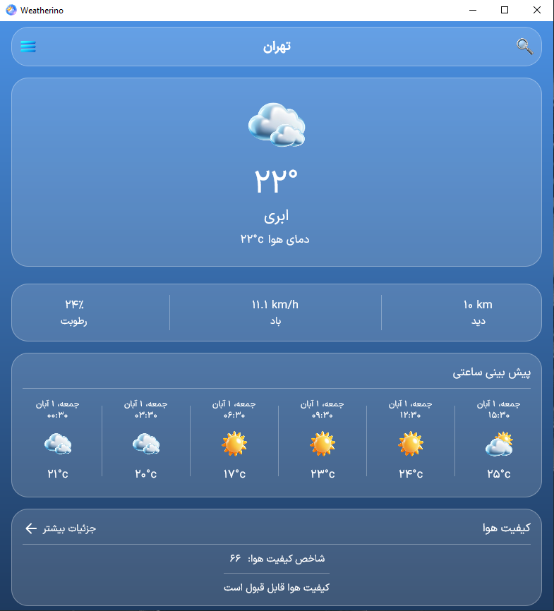

# Weatherino 🌤️

A modern cross-platform weather application built with **Kotlin Multiplatform** and **Compose Multiplatform**.

Weatherino provides current weather conditions, forecasts, air quality information, city search, and location-based weather data using the **OpenWeatherMap API**, with local caching for a smoother experience.

> A portfolio project focused on modern Kotlin development, clean architecture, cross-platform UI, networking, local persistence, and scalable application structure.

---

## 📱 Screenshots

### Android

| Home | Forecast |
|:---:|:---:|
|  |  |

| Air Quality | City Search |
|:---:|:---:|
|  |  |

| Navigation Drawer | Settings |
|:---:|:---:|
|  |  |

### Desktop



---

## ✨ Features

- 🌡️ Current weather conditions
- 📅 Weather forecasts
- 🌫️ Air quality and AQI information
- 🔎 City search with geocoding
- 📍 Location-based weather on Android
- 💾 Local weather and forecast caching
- 🏙️ Selected city persistence
- 🌧️ Precipitation information
- 💨 Wind speed and direction
- 💧 Humidity and atmospheric pressure
- 🌅 Sunrise and sunset information
- 🌡️ Temperature, feels-like, minimum and maximum temperatures
- 🎨 Glassmorphism-inspired UI
- 🌐 RTL support
- 📱 Android application
- 🖥️ Desktop application

---

## 🛠️ Tech Stack

### Core

- **Kotlin 2.4**
- **Kotlin Multiplatform**
- **Compose Multiplatform**
- **Kotlin Coroutines & Flow**
- **Kotlinx Serialization**
- **Kotlinx DateTime**

### UI & Navigation

- **Compose Multiplatform**
- **Material 3**
- **Navigation Compose**
- **Material Icons Extended**
- **Coil**

### Architecture

- **MVVM**
- **Clean Architecture**
- **Koin** for Dependency Injection
- **Repository Pattern**
- **Use Case Pattern**

### Networking

- **Ktor Client**
- **Kotlinx Serialization**
- **OpenWeatherMap API**

### Local Storage

- **SQLDelight**
- **Multiplatform Settings**

### Platform Services

- **Google Play Services Location** — Android location
- **BuildKonfig** — build-time configuration
- **Kermit** — multiplatform logging

---

## 🏗️ Architecture

Weatherino follows **Clean Architecture** with an **MVVM** presentation layer.

```text
┌─────────────────────────────────────┐
│              UI Layer               │
│        Compose Multiplatform        │
│     Screens • Components • Nav      │
└──────────────────┬──────────────────┘
                   │
┌──────────────────▼──────────────────┐
│          Presentation Layer         │
│              ViewModels             │
│          State • Events • UI        │
└──────────────────┬──────────────────┘
                   │
┌──────────────────▼──────────────────┐
│             Domain Layer            │
│       Models • Repositories         │
│             Use Cases               │
└──────────────────┬──────────────────┘
                   │
┌──────────────────▼──────────────────┐
│              Data Layer             │
│ Repository • Remote • Local Cache   │
│         Ktor • SQLDelight           │
└─────────────────────────────────────┘
```

The shared module contains the application's common business logic, domain models, repositories, use cases, ViewModels, and most of the Compose UI.

Platform-specific source sets provide implementations for functionality that depends on the underlying platform.

---

## 🌐 API & Data

Weatherino uses the **OpenWeatherMap API** for weather-related data.

The application consumes:

- Current Weather API
- Forecast API
- Geocoding API
- Air Pollution API

Remote DTOs are mapped into domain models before reaching the presentation layer.

### Local caching

Weatherino uses **SQLDelight** to cache weather and forecast data locally.

The cache allows the application to retain recently fetched data and reduces unnecessary network requests.

City-related preferences are stored using **Multiplatform Settings**.

---

## 📦 Project Structure

```text
Weatherino/
│
├── androidApp/
│   └── Android application entry point
│
├── desktopApp/
│   └── Desktop/JVM application entry point
│
├── shared/
│   ├── src/
│   │   ├── commonMain/
│   │   │   ├── core/
│   │   │   │   ├── common/
│   │   │   │   ├── database/
│   │   │   │   ├── di/
│   │   │   │   ├── network/
│   │   │   │   └── ...
│   │   │   │
│   │   │   ├── data/
│   │   │   │   ├── local/
│   │   │   │   ├── remote/
│   │   │   │   └── repository/
│   │   │   │
│   │   │   ├── domain/
│   │   │   │   ├── model/
│   │   │   │   ├── repository/
│   │   │   │   └── usecase/
│   │   │   │
│   │   │   ├── presentation/
│   │   │   │   ├── navigation/
│   │   │   │   ├── screen/
│   │   │   │   ├── ui/
│   │   │   │   ├── util/
│   │   │   │   └── viewmodel/
│   │   │   │
│   │   │   └── composeResources/
│   │   │
│   │   ├── androidMain/
│   │   │   └── Android-specific implementations
│   │   │
│   │   └── jvmMain/
│   │       └── Desktop/JVM-specific implementations
│   │
│   └── sqldelight/
│       └── io/github/sadeqit/weatherino/database/
│           ├── WeatherCache.sq
│           ├── ForecastCache.sq
│           └── ...
│
├── gradle/
│   └── libs.versions.toml
│
├── local.properties
└── README.md
```

### `core`

Contains cross-cutting infrastructure such as dependency injection, database configuration, networking, platform abstractions, and shared utilities.

### `data`

Contains remote API models, local data sources, cache implementations, DTO mappers, and repository implementations.

### `domain`

Contains business logic that is independent of external frameworks:

- Domain models
- Repository contracts
- Use cases

### `presentation`

Contains the UI and presentation logic:

- Screens
- ViewModels
- Navigation
- UI components
- UI utilities
- Application state

### `sqldelight`

Contains the `.sq` database definitions used to generate the SQLDelight database layer.

---

## 🔑 Configuration

Weatherino requires an **OpenWeatherMap API key**.

Create a `local.properties` file in the project root:

```properties
OPENWEATHER_API_KEY=YOUR_API_KEY
```

The key is read during the build and exposed to the shared module through **BuildKonfig**.

`local.properties` contains environment-specific values and should **not be committed to the repository**.

> Never commit a real API key to Git.

### Android Location

Android location functionality uses **Google Play Services Location**.

The Android application requires location permissions in the manifest and requests the appropriate runtime permission when location-based weather is used.

No `google-services.json` file is required because Weatherino does not use Firebase or the Google Services Gradle Plugin.

### Desktop Location

The Desktop/JVM version does not use Android's Google Play Services Location API.

Location-based weather is therefore an **Android-specific feature**. On Desktop, users can use the city search functionality to select a location.

---

## 🚀 Getting Started

### Requirements

- Android Studio
- JDK 21
- Android SDK
- OpenWeatherMap API key

Clone the repository:

```bash
git clone https://github.com/sadeqit/weatherino.git
cd weatherino
```

Configure the API key in `local.properties`, then build the application.

---

## ▶️ Build & Run

### Android

Build the Android debug APK:

```bash
./gradlew :androidApp:assembleDebug
```

Windows:

```powershell
.\gradlew.bat :androidApp:assembleDebug
```

### Desktop

Run the Desktop application:

```bash
./gradlew :desktopApp:run
```

Windows:

```powershell
.\gradlew.bat :desktopApp:run
```

---

## 🔄 CI/CD

Weatherino uses **GitHub Actions** to automate project validation and build tasks.

The CI pipeline is intended to verify:

- Shared module tests
- Android build
- Desktop build
- Multiplatform project compilation

Sensitive configuration such as the OpenWeatherMap API key is kept outside the repository and is not committed to source control.

---

## 🧩 Technical Challenges

### Kotlin Multiplatform Dependency Injection

One of the challenges was designing dependency injection so that shared code could use **Koin** while platform-specific dependencies could still be provided by Android and Desktop implementations.

Platform modules provide their required dependencies while the shared layer remains platform-independent.

### Local Weather Caching

Weather data is remote and can change frequently, while unnecessary network requests should be avoided.

Weatherino uses **SQLDelight** to persist weather and forecast data locally. Repository logic determines when remote data should be requested and when cached data can be used.

### Platform-Specific Location

Android provides location services through Google Play Services, while the Desktop/JVM target does not have the same platform APIs.

The location implementation is therefore isolated behind platform-specific code instead of coupling the shared business logic to Android APIs.

### Shared UI and Business Logic

Weatherino uses Compose Multiplatform to share UI while keeping platform-specific functionality isolated.

This allows the same application architecture to support Android and Desktop without duplicating the core business logic.

### API DTO to Domain Mapping

OpenWeatherMap responses are represented by network-specific DTOs.

These DTOs are mapped into domain models so that the rest of the application does not depend directly on the external API response structure.

---

## 🧪 Testing

The project includes multiplatform test support for shared and platform-specific code.

Example Gradle tasks:

```bash
./gradlew :shared:testAndroidHostTest
./gradlew :shared:jvmTest
```

---

## 📱 Supported Platforms

| Platform | Status |
|---|---|
| Android | ✅ Primary |
| Desktop (JVM) | ✅ Supported |
| Web | 🚫 Not currently maintained |
| iOS | — |

Android is the primary production target.

Desktop support is provided as a cross-platform JVM implementation and portfolio demonstration.

---

## 🎯 What This Project Demonstrates

Weatherino was built to gain practical experience with modern Kotlin development rather than simply demonstrate a collection of libraries.

Key outcomes include:

- Building a real application with **Kotlin Multiplatform**
- Sharing business logic across platforms
- Sharing Compose UI between Android and Desktop
- Applying **Clean Architecture** to a multiplatform project
- Managing dependencies with **Koin**
- Building a networking layer with **Ktor**
- Designing a local persistence and caching layer with **SQLDelight**
- Integrating Android location services
- Working with external REST APIs
- Handling platform-specific implementations
- Building a modern Compose-based UI
- Structuring a project for maintainability and future expansion

---

## 📌 Project Status

Weatherino is currently developed as a portfolio project with **Android as the primary target** and Desktop support for cross-platform development and demonstration.

The Android release build is configured for signed production builds.

A public Café Bazaar release will be added when the application is published.

---

## 👨‍💻 Author

**Sadegh Yazdi**

Android Developer | Kotlin | Jetpack Compose

GitHub: [@sadeqit](https://github.com/sadeqit)

---

## 📄 License

This project is licensed under the MIT License. See the [LICENSE](LICENSE) file for details.
