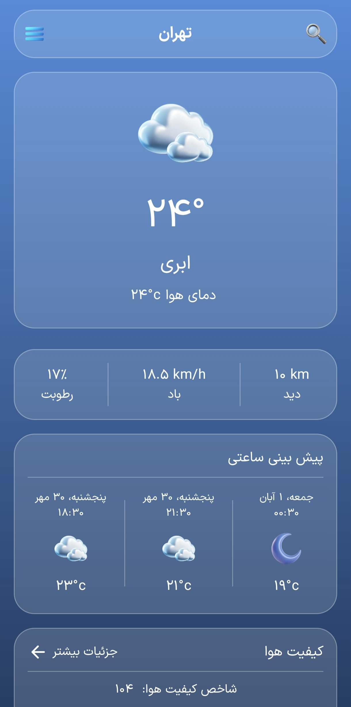
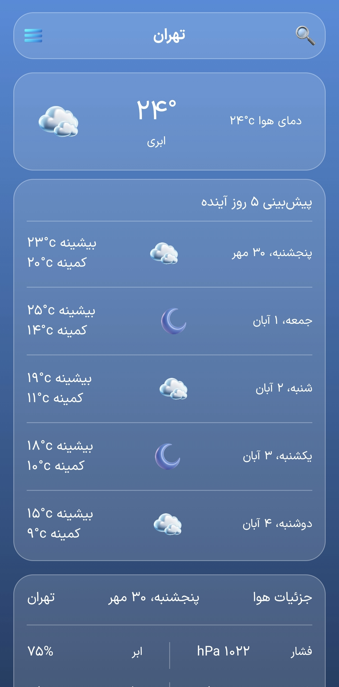
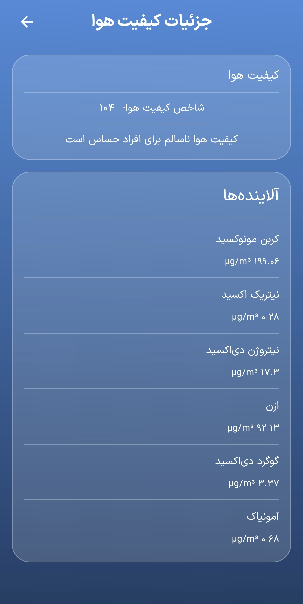
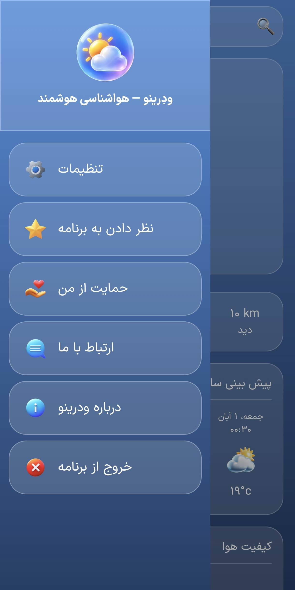
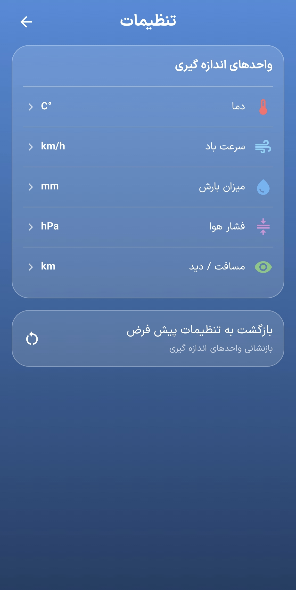

# Weatherino 🌤️

A modern cross-platform weather application built with **Kotlin Multiplatform** and **Compose Multiplatform**.

Weatherino provides current weather conditions, forecasts, air quality information, city search, and location-based weather data using the **OpenWeatherMap API**, with local caching for a smoother and more reliable experience.

> A portfolio project focused on modern Kotlin development, Clean Architecture, multiplatform UI, networking, local persistence, dependency injection, and maintainable application design.

---

## 📱 Screenshots

### Android

| City Selection | Home | Forecast |
|:---:|:---:|:---:|
|  |  |  |

| Air Quality | Navigation Drawer | Settings |
|:---:|:---:|:---:|
|  |  |  |

### Desktop


---

## ✨ Features

- 🌡️ Current weather conditions
- 📅 Weather forecasts
- 🌫️ Air quality and AQI information
- 🔎 City search with geocoding
- 📍 Location-based weather on Android
- 💾 Local weather, forecast, and air-quality caching
- 🏙️ Selected city persistence
- 🌧️ Precipitation information
- 💨 Wind speed and direction
- 💧 Humidity and atmospheric pressure
- 👁️ Visibility information
- 🌅 Sunrise and sunset information
- 🌡️ Current, feels-like, minimum, and maximum temperatures
- 🎨 Glassmorphism-inspired UI
- 🌐 RTL support
- 📱 Android application
- 🖥️ Desktop application
- 🌐 Web application
- 🔌 Offline-friendly cached weather data

---

## 🛠️ Tech Stack

### Core

- **Kotlin 2.4.20
- **Kotlin Multiplatform**
- **Compose Multiplatform**
- **Kotlin Coroutines & Flow**
- **Kotlinx Serialization**
- **Kotlinx DateTime**

### UI & Navigation

- **Compose Multiplatform**
- **Material 3**
- **Navigation Compose**
- **Material Icons Extended**
- **Coil**

### Architecture

- **MVVM**
- **Clean Architecture**
- **Koin** for Dependency Injection
- **Repository Pattern**
- **Use Case Pattern**
- Platform-specific implementations

### Networking

- **Ktor Client**
- **Kotlinx Serialization**
- **OpenWeatherMap API**

### Local Storage

- **SQLDelight**
- **Multiplatform Settings**

### Platform Services

- **Google Play Services Location** — Android location services
- **BuildKonfig** — build-time configuration
- **Kermit** — multiplatform logging

### Build & Tooling

- **Gradle**
- **Gradle Version Catalog**
- **GitHub Actions**
- **JDK 21**

---

## 🏗️ Architecture

Weatherino follows **Clean Architecture** with **MVVM** for presentation logic.

```text
┌─────────────────────────────────────┐
│               UI Layer              │
│        Compose Multiplatform        │
│      Screens • Components • Nav     │
└──────────────────┬──────────────────┘
                   │
┌──────────────────▼──────────────────┐
│          Presentation Layer         │
│              ViewModels             │
│           State • Events • UI       │
└──────────────────┬──────────────────┘
                   │
┌──────────────────▼──────────────────┐
│             Domain Layer            │
│       Models • Repositories         │
│             Use Cases               │
└──────────────────┬──────────────────┘
                   │
┌──────────────────▼──────────────────┐
│              Data Layer             │
│     Repository • Remote • Local     │
│          Ktor • SQLDelight          │
└─────────────────────────────────────┘
```

The `shared` module contains the majority of the application's business logic, domain models, repositories, use cases, ViewModels, and Compose UI.

Platform-specific source sets provide implementations for functionality that depends on the underlying platform.

This structure keeps the business logic independent from platform APIs while allowing each platform to provide its own required implementations.

---

## 🌐 API & Data

Weatherino uses the **OpenWeatherMap API** for weather-related data.

The application consumes:

- Current Weather API
- Forecast API
- Geocoding API
- Air Pollution API

Remote API responses are represented by platform-independent DTOs and mapped into domain models before reaching the presentation layer.

This keeps the domain and UI layers independent from the external API response structure.

### Local Caching

Weatherino uses **SQLDelight** for persistent local caching.

The application stores:

- Current weather data
- Forecast data
- Air quality data

Cached data allows the application to retain recently fetched information and provides a better experience when network connectivity is unavailable or limited.

City-related preferences are stored using **Multiplatform Settings**.

---

## 📦 Project Structure

Weatherino is organized as a Kotlin Multiplatform project with separate Android, Desktop, and Web applications backed by a shared module.

```text
Weatherino/
├── .github/
│   └── workflows/
│       └── ci.yml                       # GitHub Actions workflow
│
├── androidApp/                          # Android application
├── desktopApp/                          # Desktop/JVM application
├── webApp/                              # Web application
│
├── shared/                              # Shared KMP module
│   ├── src/
│   │   ├── commonMain/
│   │   │   ├── kotlin/io/github/sadeqit/weatherino/
│   │   │   │   ├── core/               # Infrastructure & utilities
│   │   │   │   ├── data/               # Remote/local data & repositories
│   │   │   │   ├── domain/             # Business logic
│   │   │   │   ├── platform/           # Platform abstractions
│   │   │   │   └── presentation/       # UI, navigation & ViewModels
│   │   │   │
│   │   │   ├── composeResources/       # Fonts & drawable resources
│   │   │   └── sqldelight/             # SQLDelight schemas
│   │   │
│   │   ├── androidMain/                # Android implementations
│   │   ├── jvmMain/                    # Desktop/JVM implementations
│   │   ├── jsMain/                     # JavaScript Web implementations
│   │   ├── wasmJsMain/                 # WebAssembly implementations
│   │   ├── commonTest/                 # Shared tests
│   │   ├── androidHostTest/            # Android host tests
│   │   └── jvmTest/                    # Desktop/JVM tests
│   │
│   └── build.gradle.kts
│
├── docs/
│   └── screenshots/                    # README screenshots
│
├── gradle/
│   ├── libs.versions.toml              # Dependency versions
│   ├── gradle-daemon-jvm.properties    # JVM toolchain configuration
│   └── wrapper/                        # Gradle Wrapper
│
├── .gitignore
├── build.gradle.kts
├── settings.gradle.kts
├── gradle.properties
├── LICENSE
└── README.md
```

### `core/`

Contains shared infrastructure and cross-cutting functionality:

```text
core/
├── common/          # Koin setup & application modules
├── database/        # SQLDelight database configuration
├── network/         # Ktor HTTP client & network checking
└── util/            # Shared utilities
```

### `data/`

Responsible for remote communication, local persistence, mapping, caching, and repository implementations.

```text
data/
├── local/           # Cache data sources & city preferences
├── model/           # DTO-to-domain mappers
├── remote/
│   ├── api/         # OpenWeatherMap API
│   └── model/       # Network DTOs
└── repository/      # Repository implementations
```

### `domain/`

Contains framework-independent business logic:

```text
domain/
├── model/           # Weather, forecast, city, AQI & units
├── repository/      # Repository contracts
└── usecase/         # Application use cases
```

Use cases handle operations such as:

- Retrieving current weather
- Retrieving forecasts
- Retrieving air quality
- Searching cities
- Reading cached data
- Checking network connectivity
- Restoring the saved city

### `presentation/`

Contains the shared Compose Multiplatform UI and presentation logic.

```text
presentation/
├── component/
│   ├── air/         # Air-quality components
│   ├── background/  # Weather background
│   ├── drawer/      # Navigation drawer
│   ├── glass/       # Glassmorphism components
│   ├── home/        # Home components
│   └── weather/     # Forecasts & weather details
│
├── navigation/      # Routes & application navigation
├── screen/
│   ├── about/
│   ├── air/
│   ├── city/
│   ├── contact/
│   ├── home/
│   ├── settings/
│   ├── splash/
│   └── support/
│
├── theme/           # Colors, typography, shapes & theme
└── viewmodel/       # ViewModels & UI states
```

### Platform-Specific Code

Platform-dependent functionality is isolated in the platform source sets.

#### Android

```text
androidMain/kotlin/io/github/sadeqit/weatherino/
├── Platform.android.kt
├── core/
│   ├── common/                      # Android Koin setup
│   ├── database/                    # Android database module
│   ├── di/                          # Location & network modules
│   └── network/                     # Android network checker
├── data/local/                      # Android SQLDelight driver
└── platform/
    ├── location/                    # Android location services
    ├── app/                         # Android app lifecycle/exit handling
    ├── OpenLink.android.kt
    └── RateApp.android.kt
```

#### Desktop / JVM

```text
jvmMain/kotlin/io/github/sadeqit/weatherino/
├── Platform.jvm.kt
├── core/
│   ├── common/                      # JVM platform modules
│   ├── database/                    # JVM database module
│   └── network/                     # JVM network checker
├── data/local/                      # SQLite JVM driver
└── platform/
    ├── location/                    # Desktop location implementation
    ├── app/                         # Desktop app exit handling
    ├── OpenLink.jvm.kt
    └── RateApp.jvm.kt
```

This separation keeps platform-specific APIs outside the shared business logic while allowing the common application layer to remain multiplatform.

---

## 🗄️ Database

Weatherino uses **SQLDelight** with three cache schemas:

```text
shared/src/commonMain/sqldelight/io/github/sadeqit/weatherino/database/
├── WeatherCache.sq
├── ForecastCache.sq
└── AirQualityCache.sq
```

These schemas provide persistent caching for:

- Current weather
- Weather forecasts
- Air quality

SQLDelight generates the database access layer while keeping the SQL schema explicit and type-safe.

---

## 🔑 Configuration

Weatherino requires an **OpenWeatherMap API key**.

### OpenWeatherMap API Key

1. Go to [OpenWeatherMap](https://openweathermap.org/) and create an account or sign in.
2. Open **My API keys** from your account.
3. Create a new API key and copy the generated key.
4. Create a `local.properties` file in the project root, next to `settings.gradle.kts`.
5. Add your API key:

```properties
OPENWEATHER_API_KEY=YOUR_API_KEY
```

Replace `YOUR_API_KEY` with your actual OpenWeatherMap API key.

The key is read during the build and exposed to the shared module through **BuildKonfig**.

`local.properties` contains environment-specific configuration and must not be committed to the repository.

> Never commit a real API key to Git.

> Newly created OpenWeatherMap API keys may take some time to become active.

### Android Location

Android location functionality uses **Google Play Services Location**.

The Android application requests the required runtime location permission when location-based weather is used.

No `google-services.json` file is required because Weatherino does not use Firebase or the Google Services Gradle Plugin.

### Desktop

Desktop provides its own platform-specific implementation for location-related functionality through the `jvmMain` source set.

The shared application layer does not depend directly on Android location APIs.

### Web

The Web application accesses the OpenWeatherMap API from the browser, which means the API key can potentially be exposed to users.

For production Web deployments, the API key should be restricted appropriately or requests should be routed through a secure backend/proxy.

---
## 🚀 Getting Started

### Requirements

- Android Studio
- JDK 21
- Android SDK
- OpenWeatherMap API key

### Clone

```bash
git clone https://github.com/sadeqit/weatherino.git
cd weatherino
```

Create `local.properties` and add your OpenWeatherMap API key:

```properties
OPENWEATHER_API_KEY=YOUR_API_KEY
```

---

## ▶️ Build & Run

### Android

Build the Android debug APK:

```bash
./gradlew :androidApp:assembleDebug
```

On Windows:

```powershell
.\gradlew.bat :androidApp:assembleDebug
```

### Desktop

Run the Desktop application:

```bash
./gradlew :desktopApp:run
```

On Windows:

```powershell
.\gradlew.bat :desktopApp:run
```

### Web

Run the Web application using JavaScript:

```bash
./gradlew :webApp:jsBrowserDevelopmentRun
```

On Windows:

```powershell
.\gradlew.bat :webApp:jsBrowserDevelopmentRun
```

Or using WebAssembly:

```bash
./gradlew :webApp:wasmJsBrowserDevelopmentRun
```

On Windows:

```powershell
.\gradlew.bat :webApp:wasmJsBrowserDevelopmentRun
```

---

## 🔄 CI/CD

Weatherino includes a **GitHub Actions** workflow for automated project validation.

```text
.github/
└── workflows/
    └── ci.yml
```

The workflow covers project validation such as:

- Shared module tests
- Android build
- Desktop build
- Multiplatform compilation

Sensitive configuration, including the OpenWeatherMap API key, is kept outside the repository and is not committed to source control.

---

## 🧩 Technical Challenges

### Kotlin Multiplatform Dependency Injection

A key challenge was designing dependency injection so that shared code could use **Koin** while platform-specific dependencies could still be provided independently by Android and Desktop.

Platform modules provide their required implementations while the shared layer remains platform-independent.

### Local Weather Caching

Weather data changes frequently, but repeatedly requesting the same data is unnecessary.

Weatherino uses **SQLDelight** to persist weather, forecast, and air-quality data locally.

The repository layer coordinates remote data and cached data to provide a more resilient experience when network connectivity is limited.

### Platform-Specific Location

Location APIs differ significantly between platforms.

Android uses **Google Play Services Location**, while Desktop requires its own platform-specific implementation.

Weatherino isolates this functionality behind platform abstractions instead of coupling the shared business logic directly to Android APIs.

### Shared UI and Business Logic

**Compose Multiplatform** allows Weatherino to share a significant amount of UI and application logic between Android and Desktop.

Platform-specific functionality remains isolated while the main application architecture stays consistent across targets.

### API DTO to Domain Mapping

OpenWeatherMap responses are represented by network-specific DTOs.

These DTOs are mapped into domain models before being consumed by the rest of the application.

This prevents external API structures from leaking into the domain and presentation layers.

### Multiplatform Persistence

Another challenge was providing persistent storage across platforms while keeping the repository layer platform-independent.

SQLDelight provides a shared database API while platform-specific drivers are supplied by Android and JVM implementations.

---

## 🧪 Testing

The project includes multiplatform test support for shared and platform-specific code.

```text
commonTest/          # Shared tests
androidHostTest/     # Android-specific tests
jvmTest/             # Desktop/JVM-specific tests
```

Current tests cover areas including:

- Weather use cases
- Forecast use cases
- Air-quality use cases
- Weather repository behavior
- City repository behavior
- Weather ViewModel
- City selection ViewModel

Example Gradle tasks:

```bash
./gradlew :shared:testAndroidHostTest
./gradlew :shared:jvmTest
```

> Test coverage will continue to expand as the project evolves.

---

## 📱 Supported Platforms

| Platform | Status |
|---|---|
| Android | ✅ Primary |
| Desktop (JVM) | ✅ Supported |
| Web | ✅ Supported |
| iOS | — |

**Android is the primary production target.**

Desktop support demonstrates the multiplatform architecture and provides a JVM-based version of the application.

---

## 🎯 What This Project Demonstrates

Weatherino was built as a practical Kotlin Multiplatform project rather than simply as a collection of libraries.

It demonstrates:

- Building a real application with **Kotlin Multiplatform**
- Sharing business logic across platforms
- Sharing Compose UI between Android and Desktop and Web
- Applying **Clean Architecture** to a multiplatform application
- Implementing **MVVM** with shared ViewModels
- Managing dependencies with **Koin**
- Building a networking layer with **Ktor**
- Working with REST APIs and DTO mapping
- Designing a local persistence layer with **SQLDelight**
- Implementing caching for remote weather data
- Integrating Android location services
- Handling platform-specific implementations
- Building reusable Compose UI components
- Designing a glassmorphism-inspired interface
- Structuring a project for maintainability and future expansion

---

## 📌 Project Status

Weatherino is currently a **portfolio project** with **Android as the primary target** and Desktop support as a cross-platform JVM implementation.

The Android release build is configured for signed production builds.

The application is not currently published on Café Bazaar. A public store release will be added when the application is officially published.

---

## 👨‍💻 Author

**Sadegh IT**

Android Developer | Kotlin | Jetpack Compose

GitHub: [@sadeqit](https://github.com/sadeqit)

---

## 📄 License

This project is licensed under the **MIT License**.

See the [LICENSE](LICENSE) file for details.
